  

<h1 align="center">👋 Hi, I’m Md Yeamin Talukder</h1>

  🎓 CSE Student at University of Barishal 
  💻 Passionate about solving problems, building systems, and learning AI.

  
  
  
  

---

## 💡 About Me
- 🧑‍💼 Online handle: `YH_AM_IN`
- 🧑‍💻 Competitive Programmer — Specialist at <a href="https://codeforces.com/profile/YH_AM-IN" target="_blank">Codeforces</a>
- 🌐 Web projects using **HTML, CSS, JavaScript and PHP**
- 🗃️ Familiar with SQL, MySQL and exploring deeper **Database Management**
- 💾 Interested in **Database Systems**, **Web Development**, and **LLM Models**
- 🧠 Research-oriented mindset — always experimenting & learning

 

---

## 🚀 Featured Projects

<table>
  <tr>
    <td width="50%" valign="top">
      <h3><a href="https://github.com/Yeamin-Talukder/jolpai-keyboard">🫒 Jolpai Keyboard</a></h3>
      Free, open-source, privacy-first <b>Bangla & English keyboard</b> for Android: Avro phonetic, the National (জাতীয়) layout, offline translation, voice typing, clipboard and 64 themes.  
      
      
    </td>
    <td width="50%" valign="top">
      <h3><a href="https://github.com/Yeamin-Talukder/ShareBro">📸 ShareBro</a></h3>
      Free offline Android app that <b>groups trip photos by face</b> (on-device AI) and sends each friend only their photos over Wi-Fi. LocalSend-compatible, no cloud, no account.  
      
      
    </td>
  </tr>
  <tr>
    <td width="50%" valign="top">
      <h3><a href="https://github.com/Yeamin-Talukder/Excel-Tech">🛒 Excel Tech</a></h3>
      The online shop and in-store system of Excel Tech: <b>storefront, admin panel and point of sale</b> in one codebase. <a href="https://exceltech.com.bd/">Live site</a>  
      
    </td>
    <td width="50%" valign="top">
      <h3><a href="https://github.com/Yeamin-Talukder/Yeamin-Chess-Bot">♟️ Yeamin Chess Bot</a></h3>
      A personal, <b>machine-learning powered chess engine</b> that plays exactly like me. <a href="https://yeamin-chess-bot.netlify.app/">Play it</a>  
      
    </td>
  </tr>
  <tr>
    <td width="50%" valign="top">
      <h3><a href="https://github.com/Yeamin-Talukder/BU-RESEARCH-PORTAL">🎓 BU Research Portal</a></h3>
      A web platform for academic research <b>submissions, peer review and publication</b> for Barishal University.  
      
    </td>
    <td width="50%" valign="top">
      <h3><a href="https://github.com/Yeamin-Talukder/Current-Detection">⚡ Current Detection</a></h3>
      An Android app to <b>monitor the home current timeline</b>, using Wi-Fi as the current-sensing sensor.  
      
    </td>
  </tr>
</table>

<b>More projects</b>

 

| Project | About |
|---|---|
| [Chess-app](https://github.com/Yeamin-Talukder/Chess-app) | Chess app (Kotlin) |
| [Recipe-App](https://github.com/Yeamin-Talukder/Recipe-App) | Culinary companion built with Flutter, Provider & Firebase |
| [NFC-HUB](https://github.com/Yeamin-Talukder/NFC-HUB) | PHP website ([live](https://nfc-hub.infinityfree.me/)) |
| [codeforces_analysis](https://github.com/Yeamin-Talukder/codeforces_analysis) | Website for Codeforces profile analysis ([live](https://yeamin-talukder.github.io/codeforces_analysis/)) |
| [Telegram-contest-reminder-bot](https://github.com/Yeamin-Talukder/Telegram-contest-reminder-bot) | Telegram contest reminder bot (Python) |
| [BU-CSE-Website](https://github.com/Yeamin-Talukder/BU-CSE-Website) | BU CSE website ([live](https://bu-cse.netlify.app/)) |
| [Portfolio](https://github.com/Yeamin-Talukder/Portfolio) | Portfolio ([live](https://yh-am-in.netlify.app/)) |
| [Algorithm](https://github.com/Yeamin-Talukder/Algorithm) · [LightOJ](https://github.com/Yeamin-Talukder/LightOJ) · [IUPC](https://github.com/Yeamin-Talukder/IUPC) | My algorithm templates, LightOJ solutions, IUPC problems solved |

---

## 🌐 Connect With Me

  
  
  
  
  

---

## 🧰 Tech Stack

  
  
  
  
  
  
  
  

---

## 🕒 Weekly Coding Stats

## 🏆 Codeforces Stats

  

  

  

## 📊 GitHub Stats

  

  
  

---

  🔥 <b>Md Yeamin Talukder</b> | <b>YH_AM_IN</b> | 🙌 Keep Learning, Keep Building!

